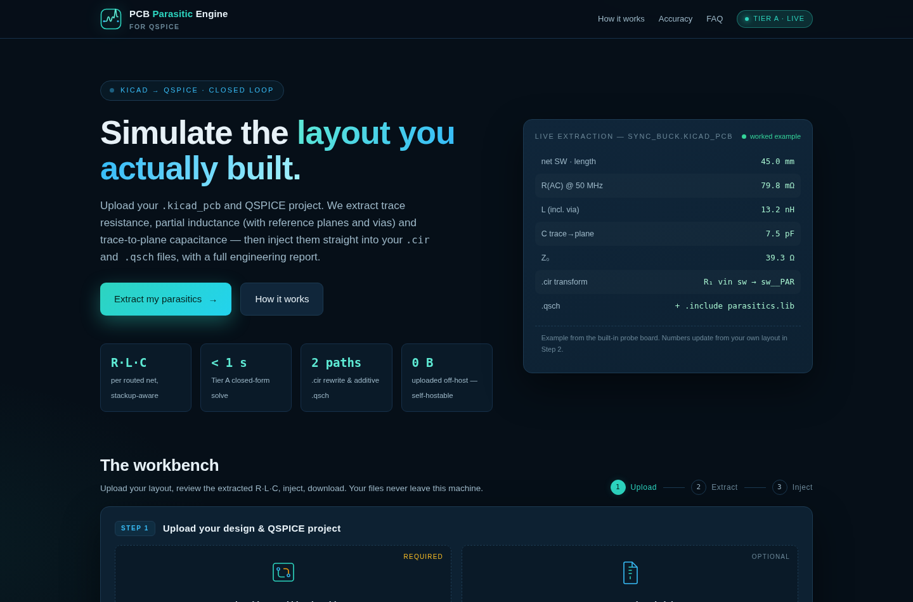
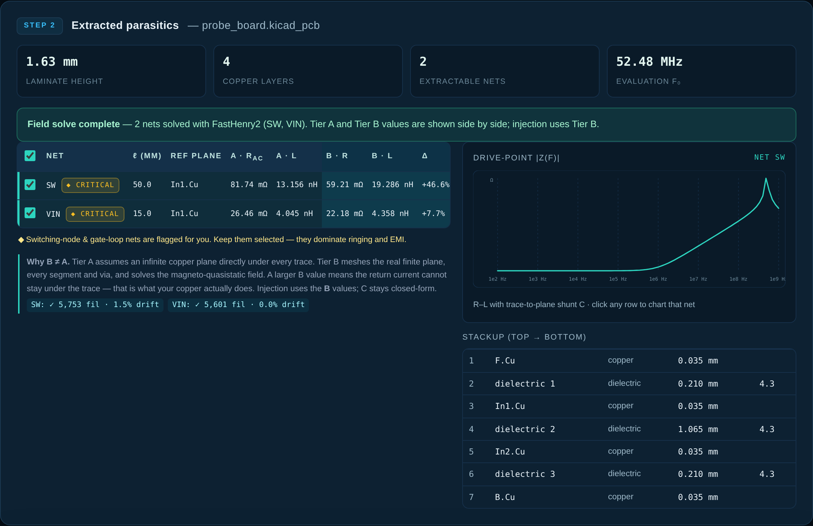

# PCB Parasitic Engine for QSPICE

> **Working name:** `pcb-parasitic-qspice` — injection of PCB-induced parasitic effects (R, L, M, C) into QSPICE simulation projects.
> **Status: 2026-11-22 — Tier A + Tier B live.** Upload KiCad `.kicad_pcb` + QSPICE project → stackup-aware R/L/C extraction, with an optional **PEEC field solve (FastHenry2)** that meshes your actual finite planes and vias → `.cir` rewrite + additive `.qsch` injection → download ZIP + self-contained HTML engineering report. 26 engine tests green. See [`plan.md`](./plan.md) for the roadmap and [`docs/TIER-B.md`](./docs/TIER-B.md) for the solver details and validation numbers.
> **v1.0 focus (locked):** power-electronics commutation loops. Injection: `.cir` netlist rewrite by default + additive `.qsch` opt-in.





Stop simulating your PCB as an ideal wire. This tool reads a **QSPICE project (ZIP)** and a **PCB design**, extracts the parasitic **resistance, self/mutual inductance, and capacitance** that the physical board introduces on every net, and produces a **new QSPICE project (ZIP)** that contains those effects — ready to simulate, ready to download, with a full engineering report attached.

---

## Why this exists

Ideal schematics hide the physics that decides whether a switching converter overshoots, a gate driver rings, a high-speed link closes its eye, or a 60 dB measurement leaks. On a real PCB, every millimeter of copper is a resistor and an inductor, every adjacent conductor is a coupled transformer and a capacitor, and every return path is shared impedance.

Published, measured work shows this is decisive in practice:

- **TU Ilmenau** demonstrated automated extraction of PCB parasitics directly from EDA data (planes → FastHenry2/FasterCap), verified against measurements ([IEEE Xplore #9472438](https://ieeexplore.ieee.org/document/9472438); [Omicron Lab presentation, 2022](https://www.omicron-lab.com/fileadmin/assets/Training_and_Events/Power_Analysis_and_Design-Symposium/2022/Presentation_TU-Ilmenau.pdf)).
- The **PCBParC** method (RLC extraction with the free MIT FastHenry/FastCap tools) reproduced rise times, overshoot and oscillations of power-converter circuits "very well" against experiment ([ResearchGate #254042181](https://www.researchgate.net/publication/254042181_Accurately_modelling_of_parasitics_in_power_electronics_circuits_using_an_easy_RLC-extraction_method)).
- The underlying theory is the **PEEC (partial element equivalent circuit)** method (Ruehli, *IEEE T-MTT*, 1974), the same foundation inside commercial extractors such as Ansys Q3D.

Commercial options (Ansys Q3D, Cadence Clarity/Sigrity, Siemens HyperLynx, Keysight Momentum, Simbeor) are excellent but expensive, closed and cannot rewrite a QSPICE project for you. **No open, dependable, end-to-end tool exists that goes from PCB layout to a runnable, parasitic-annotated QSPICE schematic.** That is the gap this project fills.

## What it does

```
 ┌───────────────────┐     ┌────────────────────┐     ┌──────────────────────────┐
 │  QSPICE project   │     │  PCB design        │     │  Project settings        │
 │  (.zip: .qsch,    │     │  (.kicad_pcb /     │     │  stackup, εr, tan δ,     │
 │   .cir, .qsym,    │ ──▶ │   Gerber+Excellon/ │ ──▶ │  copper weight, freq     │
 │   .lib, .pfg…)    │     │   IPC-2581)        │     │  range, net targets      │
 └────────┬──────────┘     └─────────┬──────────┘     └────────────┬─────────────┘
          │                          │                             │
          ▼                          ▼                             ▼
 ┌───────────────────────────────────────────────────────────────────────────┐
 │  EXTRACTION ENGINE                                                        │
 │  Tier A closed-form  ·  Tier B PEEC mesh solve (FastHenry2, live)         │
 │  finite plane · proximity effect · via loops · convergence audit          │
 └────────┬──────────────────────────────────────────────────────────────────┘
          ▼
 ┌───────────────────────────────────────────────────────────────────────────┐
 │  INJECTION + VERIFICATION                                                 │
 │  .cir netlist rewrite and/or additive "Parasitics" sheet in .qsch         │
 │  ngspice cross-check → engineering report (values, assumptions, deltas)   │
 └────────┬──────────────────────────────────────────────────────────────────┘
          ▼
 ┌────────────────────────────────────────────┐
 │  DOWNLOAD new .zip + full report (PDF/HTML)│
 └────────────────────────────────────────────┘
```

## Inputs and outputs

| Direction | Format | Notes |
|---|---|---|
| **In** | QSPICE ZIP project | `.qsch` schematic (binary-marker ASCII, magic `FF D8 FF DB` — see [`docs/RESEARCH.md`](./docs/RESEARCH.md) §4), `.cir` netlist, `.qsym`, `.lib`/`.sub` models, `.pfg`, `.cpp`, plus `.qraw` if present |
| **In** | KiCad PCB: `.kicad_pcb` | Native s-expression parser; **stackup (thickness, εr, copper) embedded** — best experience |
| **In** | Gerber RS-274X/X2 + Excellon DRL (+ optional IPC-D-356 / IPC-2581) | Stackup entered via guided wizard (Gerbers carry no dielectric data) |
| **In** | User settings | Layer stackup, εr/tan δ, frequency range of interest, target nets/components, accuracy tier |
| **Out** | New QSPICE ZIP | Original files byte-preserved + `parasitics.lib` + rewritten/augmented files as selected + `PARASITICS_REPORT.html/.pdf` |
| **Out** | Report | Extracted R/L/M/C per net & segment, solver provenance, convergence data, passivity audit, before/after netlist diff, assumptions & warnings |

## Accuracy tiers (user-selectable)

| Tier | Method | Typical runtime | Typical accuracy* | Use case |
|---|---|---|---|---|
| **A — Fast** | Closed-form (IPC-2141A / Hammerstad microstrip & stripline, Grover/Maxwell partial inductance, skin-effect) | seconds | ±5–10 % | First-pass design, large boards |
| **B — PEEC** | **FastHenry2 mesh solve (live)** for R/L — finite plane, proximity effect, via loops. Capacitance still closed-form | 0.1–3 s per net | ±2–5 % (convergence reported per net) | **Recommended default** for sign-off L/R. Validated against analytic DC R (0.00 %), the MIT `plane.in` reference (+0.9 %) and microstrip closed form (+7.7 % on a straight trace) |
| **C — Full-wave** | openEMS (FDTD) — *optional, post-MVP* | hours | <2 % | GHz links, critical nets |

\* Accuracy always depends on geometry fidelity, stackup data and mesh density; every report carries provenance and uncertainty notes. Nothing is presented as exact.

## Reliability & safety commitments

- **Non-destructive by default** — original uploaded files are preserved; injection is additive or produces a clearly-marked rewritten copy with a full diff.
- **Validation before output** — the transformed netlist is re-parsed, and an ngspice (or QSPICE, where available) cross-check runs before the ZIP is offered for download.
- **Passivity enforcement** — extracted R/L/C matrices are audited for passivity/causality; pathological extractions are rejected, not silently shipped.
- **Upload hygiene** — ZIP-bomb and path-traversal protection, size caps, per-run solver sandboxing, automatic file retention limits, no training on user designs.
- **No faked precision** — every number in the report links to the model/solver/formula and its validity range.

## Tech stack (Vercel-locked, 2026-11-22)

| Layer | Choice | Why |
|---|---|---|
| Frontend (this release) | **Next.js 14 App Router + TypeScript**, handcrafted dark EDA design system (no CSS framework dependency), deploys on Vercel | Vercel-first requirement; 93 kB First Load JS |
| Stateless browser-facing API | Next.js `rewrites()` → worker proxy (browser never calls the worker directly) | Simple, robust, no CORS in production |
| Engine (this release) | **Python FastAPI worker** `worker/` — Tier A closed-form kernel + **Tier B FastHenry2 field solve** (`pcb_engine/field.py`), same code path as CI | Field solver needs a container/host with a C toolchain once, then a 420 KB binary; TS port for Vercel-native Tier A = T-708 |
| Heavy extraction (Tier B/C) | **Container worker (Docker)**: FastHenry2 / FasterCap / ngspice subprocesses (Fly.io / Railway / Cloud Run / VM) | Vercel serverless cannot host minutes-long jobs or native solver binaries |
| Verification | ngspice smoke (planned, T-406); QSPICE batch = documented user-side / Windows step (T-407) | QSPICE is Windows-only and cannot be bundled |
| CI/CD | GitHub Actions (`.github/workflows/ci.yml`): engine unittest + web typecheck + `next build` | Professional discipline |

## Repository layout

```
pcb-parasitic-qspice/
├── README.md            ← you are here
├── making.md            ← handoff doc for ANY successor chat/AI (read first)
├── plan.md              ← checkboxed task plan (updated after every task)
├── LICENSE / NOTICE.md  ← MIT engine (open-core) + third-party licenses/trademarks
├── docs/
│   ├── RESEARCH.md      ← papers, formats, solvers, QSPICE internals (verified)
│   ├── SKILLS.md        ← AI skills inventory for building professional web apps
│   ├── TIER-B.md        ← FastHenry2 field solver: install, validation, traps, limits
│   └── assets/          ← product screenshots (workbench, engineering report)
├── apps/web/            ← Next.js 14 App Router frontend + proxy to worker (Vercel-ready)
├── worker/              ← FastAPI Tier A engine (Python)
│   ├── pcb_engine/      ←   parasitics kernel, field.py (Tier B), kicad ingest, .cir/.qsch writers, report, pipeline
│   ├── tests/           ←   26 unit/integration tests (stdlib unittest)
│   └── fixtures/        ←   probe_board.kicad_pcb (4-layer, 2 nets + vias)
├── scripts/
│   └── build-fasthenry.sh  ← builds the MIT 64-bit FastHenry + self-verifying smoke test
├── package.json         ← root convenience scripts (dev:web / dev:worker / test:worker)
├── docker-compose.yml   ← all-in-one local stack (web :3000, worker :8000)
└── .github/workflows/ci.yml  ← CI: engine tests + web typecheck + production build
```

## Quick start (works today)

```bash
git clone <this repo> && cd pcb-parasitic-qspice

# 1) engine worker (Python 3.11+)
pip install -r worker/requirements.txt
python3 -m uvicorn main:app --app-dir worker --host 0.0.0.0 --port 8000

# 2) web app (Node 20+), second terminal
npm --prefix apps/web ci
WORKER_URL=http://127.0.0.1:8000 npm --prefix apps/web run dev
# → open http://localhost:3000
```

Or one command for the whole stack: `docker compose up --build` (web :3000, worker :8000).

Engine tests: `python3 -m unittest discover -s worker/tests -v`

**Enable the Tier B field solver** (optional, one command, MIT-licensed):
```bash
./scripts/build-fasthenry.sh     # → worker/vendor/fasthenry/bin/fasthenry + DC smoke test
# then start the worker with FH_BIN pointing at it (or use docker compose, which builds it for you)
```
Without it the app still works — it falls back to Tier A and says so in `/health`, the UI and the report.
Web type-check + build: `npm --prefix apps/web run typecheck && npm --prefix apps/web run build`

**Vercel (frontend):** set project Root Directory to `apps/web`, add env `WORKER_URL=https://<your-worker>`; the UI proxies `/api/*` to the worker server-side (browser never needs the worker URL). Without a worker, the upload flow reports a clear error — full Tier A in-browser kernel (`packages/kernel`) is tracked as T-708.

## Honesty & limitations

- QSPICE is a **Windows-only, Qorvo-proprietary** tool; it is **not bundled**. Server-side verification uses ngspice (SPICE-compatible) as a proxy; final fidelity checks on the user's QSPICE install are recommended.
- `.qsch` has **no public specification**. We verified its actual structure from real files (magic `FF D8 FF DB`, ASCII records with `0xAB`/`0xBB` markers). Schematic-mode injection is therefore **additive-only** by design, with snapshot tests against a corpus of real QSPICE files.
- Gerber carries **no dielectric stackup** — stackup must come from KiCad files, IPC-2581, or a guided user wizard.
- Frequency-dependent resistance: Tier B gives a true mesh solve at f₀ (skin **and** proximity effect); Tier A uses a perimeter skin-effect approximation. Multi-frequency Foster ladders are T-306. Mutual inductance uses `K` statements with documented sign conventions.
- **Capacitance is always closed-form** in this release — no electrostatic field solver is wired (FastCap's 1992 allocator hangs on 64-bit; FasterCap is wxWidgets-3.0/GPL-bound). Treat C as ±10 % and re-check against the fab stackup.
- **Vercel runs only Tier A** (closed-form, <1 s, no native binaries) and the UI; **Tier B/C field-solver jobs require the container worker** — deployed separately (Fly.io / Railway / Cloud Run / VM). Without it, Tier A mode still produces usable L/C/R estimates with reduced accuracy, clearly labeled.
- This is an engineering tool, not a certification. Reports state assumptions; the user is responsible for final design review.

## License

**Open-core** (decision OQ-06): the engine and web application source in this repository are [MIT](./LICENSE). A hosted/managed service, if offered, will be governed by separate commercial terms published before v1.0. Third-party components and trademarks are listed in [`NOTICE.md`](./NOTICE.md). QSPICE itself is not bundled and remains the property of Qorvo, Inc.

## References

See [`docs/RESEARCH.md`](./docs/RESEARCH.md) — papers (Ruehli, Kamon/White, Nabors/White, Hammerstad, IPC-2141A), TU Ilmenau/PCBParC validation work, QSPICE file-format findings, and the full source list.
